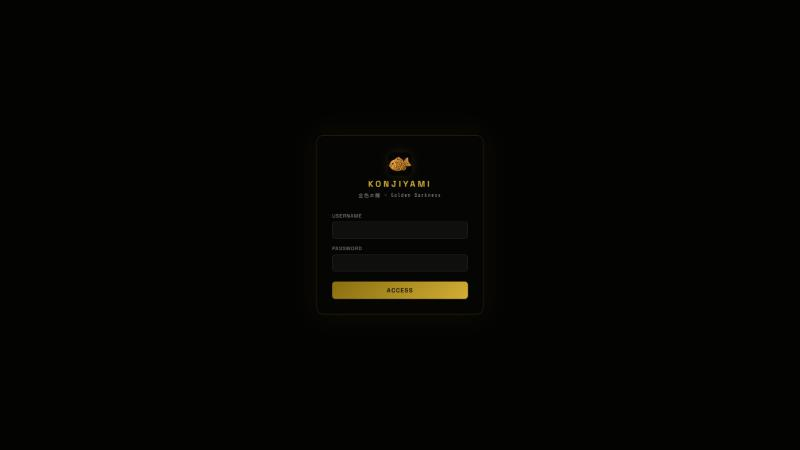
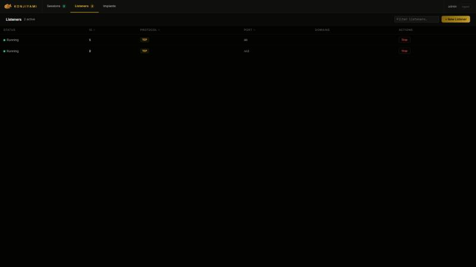
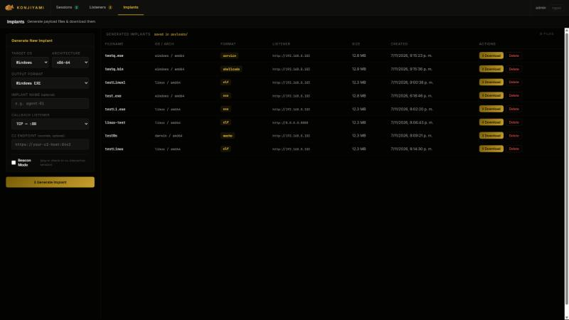
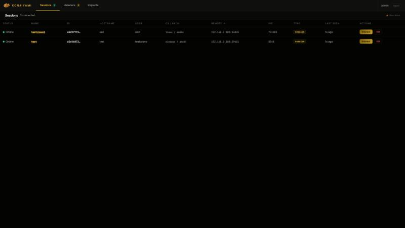
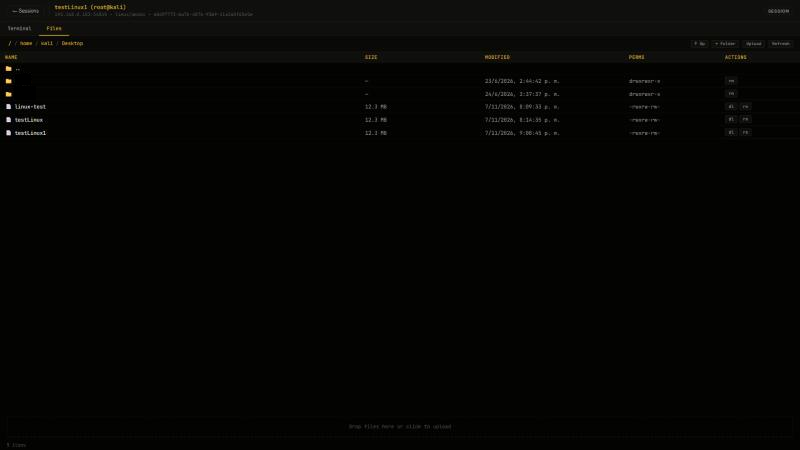
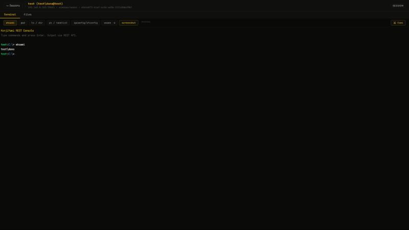
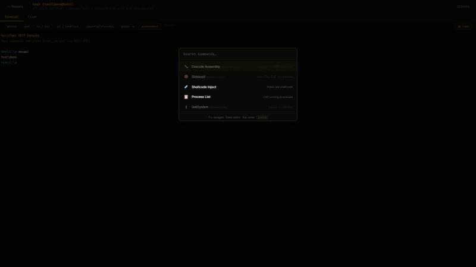

# KonjiYami

Command & Control framework. Single binary, REST API + embedded web UI, cross-platform implant generation.

<p align="center">
  
  
  
  
</p>

## Screenshots

| | |
|---|---|
|  **Login** |  **Listeners** |
|  **Implant Generator** |  **Sessions** |
|  **Interactive Terminal** |  **File Browser** |
|  **Command Execution** |  **Advanced Execution Menu** |

## Features

| Capability | Details |
|---|---|
| **Sessions** | Interactive mTLS/HTTP sessions, xterm.js terminal, quick-action buttons |
| **Beacons** | Async check-in agents, configurable interval + jitter |
| **Listeners** | mTLS, HTTP/S |
| **Implant Generator** | Windows (EXE/DLL/Service), Linux (ELF/.so), macOS (Mach-O/.dylib) — format adapts to target OS |
| **Garble Obfuscation** | Compile-time obfuscation via [Garble](https://github.com/burrowers/garble) — randomized seeds, literal encryption, symbol stripping |
| **GetSystem** | Token theft via `DuplicateTokenEx` + `CreateProcessWithTokenW` — spawns SYSTEM beacon |
| **File Browser** | ls, cd, pwd, download, upload, mkdir, rm — breadcrumb navigation |
| **Process List** | Remote process enumeration |
| **Execute Assembly** | In-memory .NET assembly execution |
| **Sideload** | Reflective DLL injection |
| **Shellcode Inject** | Raw shellcode injection into remote processes |
| **Screenshots** | Remote desktop capture |
| **WebSocket Events** | Real-time session/beacon/listener notifications |
| **Auth** | JWT (access + refresh tokens), RBAC (admin/operator/viewer), JSONL audit log |

## Quick Start

### Prerequisites

- Go 1.22+
- Windows, Linux, or macOS (server host)
- DLL / shared library implants require `CGO_ENABLED=1` and `gcc` in PATH ([MinGW-w64](https://www.mingw-w64.org/) on Windows). Standard implants do not need CGO.

### Build

```bash
# Server
GOWORK=off go build -tags "osusergo,netgo,gosqlite,server" -o konjiyami-server ./server/

# Client
GOWORK=off go build -tags "osusergo,netgo,gosqlite,client" -o konjiyami-client ./client/
```

Windows (PowerShell):

```powershell
$env:GOWORK="off"; go build -tags "osusergo,netgo,gosqlite,server" -o konjiyami-server.exe ./server/
$env:GOWORK="off"; go build -tags "osusergo,netgo,gosqlite,client" -o konjiyami-client.exe ./client/
```

### Run

```bash
./konjiyami-server daemon --insecure   # HTTP :8080, gRPC :31337
```

Web UI: `http://127.0.0.1:8080`

CLI client:

```bash
./konjiyami-client http --host 127.0.0.1 --port 8080 -u admin -p konjiyami
```

Default credentials: `admin` / `konjiyami` — change after first login.

## Project Layout

```
server/
  api/            REST endpoints, JWT auth, middleware
  c2/             Listener management (mTLS, HTTP)
  core/           In-memory state (Jobs, Sessions, Beacons, Events)
  generate/       Implant compilation pipeline
  db/             SQLite (GORM)
  rpc/            gRPC handlers
  ui/public/      Embedded web UI (go:embed)
client/           CLI client (Cobra, gRPC + HTTP transports)
implant/          Implant source
protobuf/         Protocol Buffers
```

## Legal

For authorized security testing and education only. See [DISCLAIMER.md](DISCLAIMER.md).

## License

GPLv3
